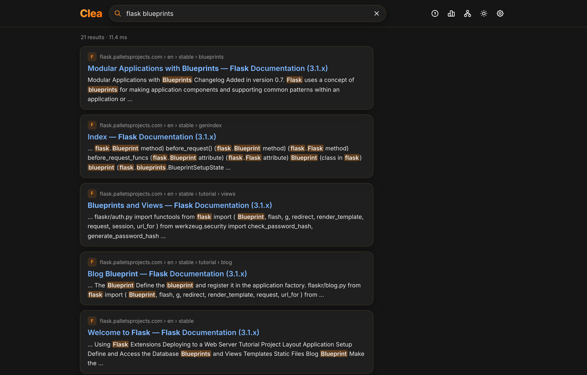

# Clea: A Search Engine


[](https://github.com/dsameendra/clea/actions/workflows/ci.yml)

> Cléa — from *clé* (key), unlocking answers.

Clea is a small, self-hosted search engine. Give it the sites you care about; it crawls them politely, builds a
full-text index and gives you a fast, clean search page for them. It also runs as a fully static demo on
GitHub Pages, with search happening in the browser.



## Features

**Search**
- Full-text search with BM25 ranking (SQLite FTS5), stemming, and title/URL boosting
- Query-aware snippets with highlighted matches
- Search syntax: `"exact phrase"`, `-exclude`, `prefix*`, `site:example.com`, `intitle:word`
- Falls back to "any word" when nothing matches every word, and suggests spelling corrections ("Did you mean …")
- Autocomplete as you type
- Instant answers in the browser: a calculator (`15% of 240`, `sqrt(2)*10`, `5!`) and unit conversion
  (`10 km in miles`, `72 f to c`, `1.5 gib in mb`)
- Shareable result URLs (`?q=…&p=2`), pagination, `/` to focus search, light/dark theme
- OpenSearch, so you can add Clea as a search engine in your browser

**Crawling**
- Crawls each site breadth-first within its host and path (e.g. only `/docs/`), with page and depth limits
- Respects robots.txt (including `Crawl-delay` and `Sitemap`), `<meta name="robots">` and `rel="nofollow"`,
  waits between requests to the same host, and sends an identifying User-Agent
- Reads sitemaps, follows canonical URLs and same-site redirects, normalises URLs and skips duplicates and non-HTML files
- Recrawls use `ETag` / `Last-Modified`, so unchanged pages cost almost nothing; pages that disappear leave the index
- **Parallel:** different sites are crawled at the same time (4 by default), while each site still gets one request at
  a time
- **Automatic crawling:** look for new pages every N minutes, and refresh every page every N hours or days, set from
  the admin panel. Sites can be left out individually
- Crawls run in the background with live progress, an optional time limit, and can be cancelled
- Pages that are mostly links (generated indexes, sitemaps) are ranked below the pages they point to

**Running it**
- One process: the Python server serves the API and the built web app
- An admin token protects site management whenever the server is reachable from the network
- Docker image and Compose file
- Static GitHub Pages build updated by a scheduled GitHub Action

## Quick start

Requirements: Python 3.11+ and Node.js 20+.

```bash
git clone https://github.com/dsameendra/clea.git
cd clea

# Backend
python3 -m venv .venv
source .venv/bin/activate            # Windows: .venv\Scripts\activate
pip install -r requirements.txt

# Frontend
cd frontend && npm install && npm run build && cd ..

# Run
python -m clea serve
```

Open <http://localhost:6942>, click the **sitemap** icon, add a site (for example
`https://docs.python.org/3/tutorial/`) and press **Crawl new pages**. Results become searchable as pages are indexed.

To load the demo's site list instead: `python -m clea sites import sites.toml`.

### Developing the frontend

Run the backend (`python -m clea serve`) and, in another terminal, the Vite dev server (it proxies `/api` to the
backend):

```bash
cd frontend
npm run dev        # http://localhost:5173
```

## Command line

```bash
python -m clea serve [--host 127.0.0.1] [--port 6942]
python -m clea sites add https://example.com/docs/ --max-pages 200 --max-depth 3
python -m clea sites list
python -m clea sites remove 3
python -m clea sites import sites.toml [--prune]
python -m clea crawl [--site 1] [--recrawl] [--workers 4] [--max-seconds 600]
python -m clea schedule --discover-every 30m --refresh-every 7d [--max-run 30m] [--workers 4]
python -m clea schedule --no-discover --no-refresh      # turn automatic crawling off
python -m clea search "flask blueprints"
python -m clea stats
python -m clea export frontend/public/data     # static index for the browser
```

## Configuration

All settings are environment variables:

| Variable | Default | Meaning |
|---|---|---|
| `CLEA_DB` | `data/clea.db` | SQLite database path |
| `CLEA_HOST` / `CLEA_PORT` | `127.0.0.1` / `6942` | Where the server listens |
| `CLEA_ADMIN_TOKEN` | *(empty)* | Protects site management and crawling. **Required** when `CLEA_HOST` is not a loopback address |
| `CLEA_ALLOWED_HOSTS` | | Extra `Host` names to accept when no token is set (DNS-rebinding protection) |
| `CLEA_CORS_ORIGINS` | | Browser origins allowed to call the API from another site |
| `CLEA_CRAWLER_CONTACT` | | URL or email added to the crawler's User-Agent so site owners can reach you |
| `CLEA_MIN_DELAY` | `1.0` | Minimum seconds between requests to the same host |
| `CLEA_CRAWL_WORKERS` | `4` | Sites (hosts) crawled in parallel, until changed in the admin panel |
| `CLEA_DISCOVER_MINUTES` | `0` | Look for new pages this often (0 = off), until changed in the admin panel |
| `CLEA_RECRAWL_HOURS` | `0` | Refresh every page this often (0 = off), until changed in the admin panel |
| `CLEA_REQUEST_TIMEOUT` | `15` | Per-request timeout in seconds |
| `CLEA_MAX_PAGE_BYTES` | `5242880` | Pages larger than this are skipped |
| `CLEA_STATIC_DIR` | `frontend/dist` | Built web app to serve |

## Docker

```bash
echo "CLEA_ADMIN_TOKEN=$(openssl rand -hex 24)" > .env
docker compose up -d
```

Open <http://localhost:6942> and enter the token under **Settings** (or when the admin panel asks). The index is
kept in the `clea-data` volume. By default Compose turns on automatic crawling: new pages hourly and a full refresh
weekly (`CLEA_DISCOVER_MINUTES`, `CLEA_RECRAWL_HOURS`). You can change both in the admin panel.

## GitHub Pages demo

GitHub Pages only serves static files, so the demo works differently from a self-hosted Clea:

1. `.github/workflows/pages.yml` runs the Python crawler on the sites in [`sites.toml`](sites.toml) (on every push to
   `main`, weekly, or on demand).
2. `python -m clea export` writes the index as JSON next to the built frontend.
3. The frontend is built with `VITE_SEARCH_MODE=static`. It loads the index in a Web Worker and searches it in the
   browser with [MiniSearch](https://github.com/lucaong/minisearch): same query syntax, typo tolerance, snippets and
   suggestions. The admin panel is hidden.

To enable it, go to **Settings → Pages → Build and deployment** and set **Source** to **GitHub Actions**. Then push to
`main` or run the workflow from the **Actions** tab. Keep `sites.toml` small, because every visitor downloads the
index (a few hundred pages is a few MB).

To try the static build locally:

```bash
python -m clea export frontend/public/data
cd frontend && npm run dev:static
```

## Automatic crawling

Open the admin panel (sitemap icon) → **Automatic crawling**:

- **Look for new pages every …** (minimum 5 minutes) re-reads each site's start page, plus its sitemaps at most every
  6 hours. Newly linked pages are crawled, and pages whose sitemap `<lastmod>` is newer than Clea's copy are fetched
  again. Unchanged pages answer `304 Not Modified`, so a check of an unchanged site usually costs one small request.
- **Refresh every page every …** (minimum 1 hour) re-checks every known page, so edits and deleted pages are picked up.
- **Stop a scheduled run after …** keeps runs bounded. Sites crawled longest ago go first, so every site gets its turn.
- **Sites crawled in parallel** sets how many websites are crawled at once. Requests to any one website are never
  parallel, and each one waits `CLEA_MIN_DELAY` (or the site's robots.txt `Crawl-delay`) between requests.

The schedule runs inside `python -m clea serve`. Intervals count from the end of the previous run, and the run
history is stored in the database. A restart therefore doesn't trigger extra runs, and a run that came due while
Clea was off happens once, shortly after it starts. Use a site's **⋯ → Include in automatic crawls** to leave it
out.

When a site reaches its **Max pages**, Clea keeps its existing pages up to date but queues newly found pages without
downloading them. The site shows *page limit reached*; raise the limit to index the waiting pages.

On the GitHub Pages demo there is no server, so the equivalent is the workflow's `schedule:` cron.

## How it works

```
clea/
  glaneur.py   crawler: frontier, robots.txt, politeness, redirects, sitemaps   (French: "gatherer")
  classeur.py  HTML → title/description/main text/links; writes documents       ("organiser")
  servir.py    query parsing, FTS5/BM25 search, snippets, suggestions, stats    ("to serve")
  sites.py     site management          jobs.py    background crawl jobs + scheduler
  schedule.py  automatic crawling settings and "is a run due?"
  server.py    Flask API + web app      cli.py     command line
  db.py        schema & migrations      export.py  static index for GitHub Pages
frontend/src/
  lib/staticEngine.js   browser search engine (static mode)
  lib/instant/          calculator and unit converter (no eval)
  components/           search UI and admin panel
```

Documents are stored in SQLite and mirrored into an FTS5 index by triggers, so updates and deletions never leave
stale entries behind.

**Upgrading from Clea 1.x:** the database moved from `clea_db.db` to `data/clea.db`. The first time Clea 2 creates
its database it imports the sites from an existing `clea_db.db` in the project folder. Their pages are crawled again,
because the old index can't be converted. The old file is left untouched.

### API

| Method & path | |
|---|---|
| `GET /api/search?q=&page=&per_page=` | Search. Returns `results[{url, title, snippet, host}]`, where title and snippet are `[{text, match}]` segments, plus `total`, `suggestion` and `relaxed` |
| `GET /api/suggest?q=` | Autocomplete |
| `GET /api/stats` | Index statistics |
| `GET/POST /api/sites`, `PATCH/DELETE /api/sites/<id>` | Manage sites (admin) |
| `GET /api/sites/<id>/urls?status=failed` | Crawl problems for a site (admin) |
| `POST /api/crawl` `{site_ids?, mode?: "new" \| "recrawl"}` | Start a crawl job (admin) |
| `GET/PUT /api/crawl/settings` | Automatic crawling and parallelism settings, plus next/last run times (admin) |
| `GET /api/jobs`, `GET /api/jobs/<id>`, `POST /api/jobs/<id>/cancel` | Job progress (admin) |

## Development

```bash
pip install -r requirements-dev.txt
pytest                      # backend tests (spins up a local test website)
ruff check clea tests
cd frontend && npm test && npm run lint
```

## Contributing

Contributions are welcome! Fork the repository, create a branch, and open a pull request. Please run the tests first.

## License

MIT, see [LICENSE](LICENSE).

## Acknowledgements

[Flask](https://flask.palletsprojects.com/) · [SQLite FTS5](https://www.sqlite.org/fts5.html) ·
[Beautiful Soup](https://www.crummy.com/software/BeautifulSoup/) · [Protego](https://github.com/scrapy/protego) ·
[React](https://react.dev/) · [Mantine](https://mantine.dev/) · [MiniSearch](https://github.com/lucaong/minisearch)
